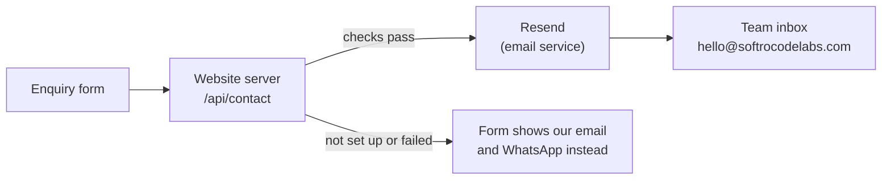
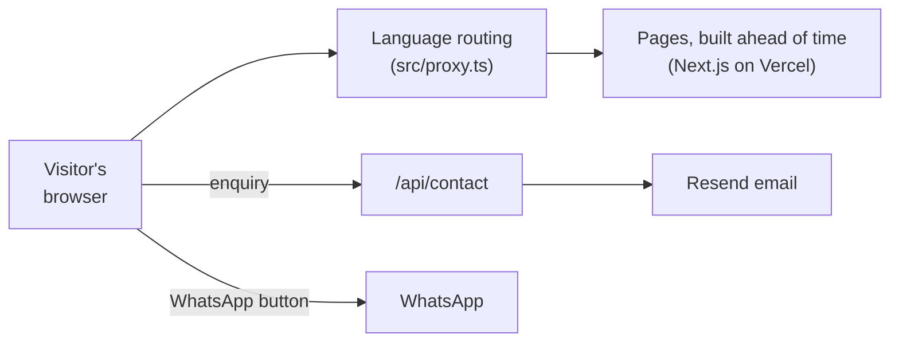

# Softro Code Labs Website: System Overview

A plain-words tour of the whole project: what the site is for, who uses it, and how a visitor becomes an enquiry in the team's inbox.

---

## What it is

**Softro Code Labs** is a software company in Balapitiya, Sri Lanka. It builds mobile apps, websites, online stores, business systems and custom software, with one team from the first idea to launch day.

**The website** (softrocodelabs.com) is the company's shop window:

- 🧭 **What we build.** Four core services, each backed by a real project, plus 14 more kinds of software in four groups: *Run your business*, *Grow online*, *Work smarter* and *Made just for you*.
- 💼 **Real work.** Case studies for Ola Kids (mobile app), Baileyn (online store) and Tourvista Tours (travel website), with screenshots that open full screen.
- 🧪 **The Lab.** Our own product, Swift Converter Hub: 46 free file tools that run inside the browser, so files never leave the device.
- 💬 **Easy to reach.** An enquiry form, WhatsApp with a greeting already typed, and a phone number, never more than a tap away.
- 🇱🇰 **English and Sinhala**, switchable from the header on every page.
- 🌗 **Dark and light themes**, following the visitor's device until they choose.

## Who uses it

| Who | What they do |
|---|---|
| **Visitors** (business owners, people with an idea) | Read about our services and work, then send an enquiry |
| **The Softro team** | Receives enquiries by email and replies within 2 working days. Updates the wording, projects and screenshots |
| **Search engines and link previews** | Read each page's title, description, business details and share picture |

## The pages

Every page exists in both languages: `/work` in English, `/si/work` in Sinhala.

| Page | Address | What it's for |
|---|---|---|
| **Home** | `/` | The main message, real numbers, what we build, selected work, the Lab, our process |
| **Services** | `/services` | The four core services with a real example each, and everything else we can build |
| **Work** | `/work` | All client projects |
| **Case study** | `/work/baileyn` and others | The challenge, what we built, where it is now, the technology, and a screenshot gallery |
| **The Lab** | `/lab` | Swift Converter Hub: how it works and a look inside |
| **About** | `/about` | Our story, what we care about and how we work |
| **Contact** | `/contact` | The enquiry form, what happens next, and our email, phone, WhatsApp and address |
| **Privacy policy, Terms of use** | `/privacy`, `/terms` | The legal pages |

---

## A visitor's story

1. **Discover.** The home page opens on *"We build the software your business needs."* Beside it, real screens from three client projects float at different depths and turn gently toward the pointer. Below, the real numbers count up: 3 client projects, 46 free tools, 2 languages, 2 working days to reply.
2. **Explore.** They see the four core services and the wider list of systems we can build. Each core service links to a real project, so nothing is just a promise.
3. **Trust.** A case study shows the problem, what we built and where it stands today. They can open any screenshot full screen and swipe or use the arrow keys to move through them. The four-step process (*We listen, We design, We build, We launch*) shows how we would work with them.
4. **Get in touch.** The form asks for four things: their name, an email or WhatsApp number, what they'd like to build, and a few lines about the idea. Or they tap WhatsApp, which opens with a greeting already written in their language. On phones, a small bar with **Start your project** and **WhatsApp** slides up once the page's own buttons scroll out of view.
5. **Hear back.** The team replies within 2 working days, in the language the visitor used.

## What happens to an enquiry

1. **Checked.** Name, contact and message are required, and each is trimmed to a sensible length. A hidden field catches bots: they are told "sent", but nothing is sent. One address can send at most 5 enquiries in 10 minutes.
2. **Emailed.** The team gets *"New enquiry from {name}"*, with what they want to build and which language they used. When the visitor gave an email address, pressing **Reply** answers them directly.
3. **Never lost silently.** If email isn't set up yet, the email service fails or the visitor is offline, the form says so and shows our email address and WhatsApp link, so they can still reach us.

---

## How it fits together

- **Website (Next.js on Vercel):** all 22 pages (11 in each language) are built ahead of time, so they load straight away. The only live server code is the enquiry form.
- **Content files (`src/content/`):** every word, project, screenshot caption and service lives here, separate from the design. There is no database and no admin panel. A change is a file edit and a redeploy.
- **Email (Resend):** delivers enquiries to the team inbox.

### Two languages, one site

- English lives at the plain addresses (`/work`), Sinhala under `/si` (`/si/work`). Old `/en/...` links redirect, so each page has exactly one address.
- English wording is in `src/content/`, Sinhala in `src/content/si/`. **The build fails if a Sinhala item is missing**, so no page can go live half translated.
- Search engines are told which page is the translation of which, and each language has its own titles and descriptions.
- Sinhala text uses the Yaldevi Sinhala font, sized and spaced for Sinhala letters.

### Why it's quick and honest

- **Fast on ordinary phones.** Pages are pre-built. Screenshots are served as AVIF or WebP at the right size for each screen. Sections lower down the page aren't drawn until they're near. Animations move only position and fade, and switch off when a phone asks for less motion.
- **Every number is true.** The home page figures are real counts, never rounded up. The capability list says what we *can* build, while finished work lives in case studies, so visitors can always tell the two apart.
- **Real words only.** The client quotes section stays hidden until a client has actually said or approved the words.
- **Private by design.** No tracking or advertising cookies, no analytics, no accounts. Enquiry details are used only to reply.
- **Safe defaults.** Every response carries security headers: no framing by other sites, HTTPS only, and no camera, microphone or location access.

### Built for search

- Every page has its own title and description, in both languages, written to fit Google's results.
- Shared links show a preview card with the Softro picture, on WhatsApp, Facebook, LinkedIn and X.
- Search engines get the business details (address, phone, services, Sri Lanka) and a breadcrumb trail for every page (Home › Work › Baileyn).
- A sitemap lists all 22 pages with their translations and last-updated date. Unknown addresses return a proper "page not found".

---

## Look and feel

The design comes from the logo: a crimson mark on deep night blue, with faint grid lines and soft glows, like a lab working late. Project screens sit in browser and phone frames that float in 3D.

| Colour | Used for |
|---|---|
| Night blue `#070b14` | Page background in the dark theme (the default) |
| Paper `#f5f6fa` | Page background in the light theme |
| Crimson `#ef4c5b` | Main buttons, links and highlighted words |
| Deep crimson `#a70b21` | The logo's gradient, with crimson |
| Mint `#34d399` | Status dots, such as "Open for new projects" and "Live" |

**Fonts:** Schibsted Grotesk (text and headings), Yaldevi (the Softro wordmark), Yaldevi Sinhala (Sinhala).

The site works on phones first: the menu opens full screen, the phone bar keeps the next step close, and the 3D tilt only follows a mouse or trackpad. It respects "reduce motion", keeps text contrast at 5.4:1 or better in both themes, and every screenshot has a description for screen readers.

**Also made in this project:** the logo mark in colour and two single-colour versions, the browser tab and iPhone icons, and the link-share image.

---

## Built with

Next.js 16 (App Router) · React 19 · TypeScript · Tailwind CSS v4 · Resend · Vercel

No other runtime packages: the motion, 3D frames, gallery and icons are all written in the project.

## Where to find things

| Part | Folder |
|---|---|
| Pages (one folder each) | `src/app/[lang]/` |
| Enquiry email | `src/app/api/contact/route.ts` |
| Shared sections, header, footer, 3D frames | `src/components/` |
| All wording, projects and services | `src/content/` (Sinhala in `src/content/si/`) |
| Email, phone, WhatsApp, address | `src/content/site.ts` |
| Search details and share card | `src/seo.ts` |
| Language routing | `src/proxy.ts` and `src/i18n.ts` |
| Colours, type and motion | `src/app/globals.css` |
| Screenshots, logo, share image | `public/` |

Setup, settings, common edits and going live are in the **[README](README.md)**.

---

## Good to know

- **Ola Kids** is a test build being prepared for Google Play and the App Store. **Baileyn** and **Tourvista Tours** are live. Update each project's badge when that changes.
- The client quotes section is **hidden** until real, approved quotes are added.
- The newest **Sinhala** wording is a first draft. A native speaker should check it before launch.
- **Built by Softro Code Labs**, November 2026.
